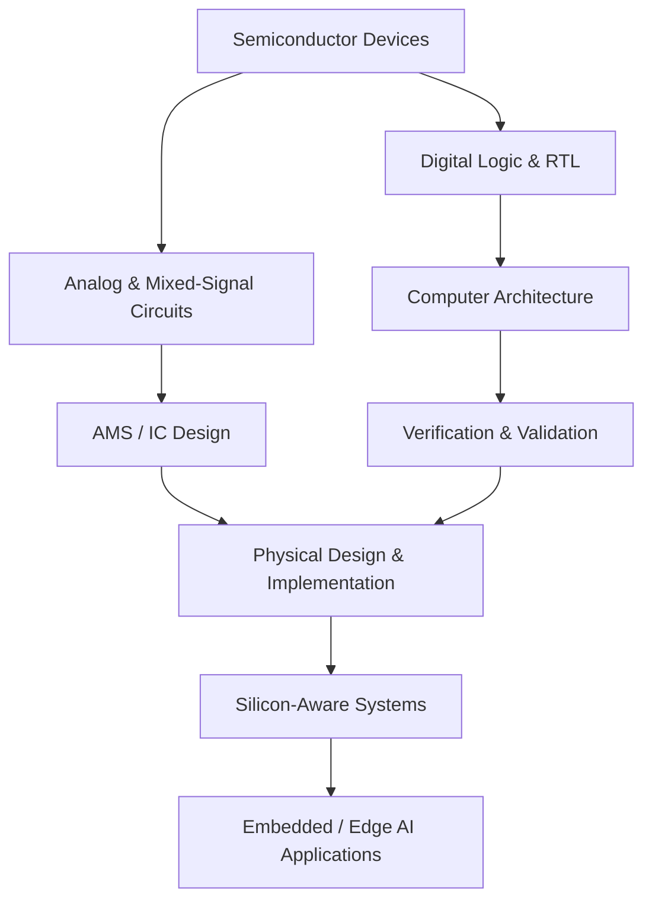

<!--
  VAMSI KRISHNA THEEGELA | GitHub Profile README
  Profile repository: https://github.com/vamsikrishnatheegela/vamsikrishnatheegela
-->
<div align="center">


<a href="https://readme-typing-svg.demolab.com">
  
</a>

<br/>

[](https://github.com/vamsikrishnatheegela)
[](https://www.linkedin.com/in/vamsi-krishna-theegela-7b9196320/)
[](https://vamsikrishnatheegela.github.io/)

</div>

---

## ░ SYSTEM BOOT

```text
> initializing profile...
> loading identity: Vamsi Krishna Theegela
> domain: Electronics Engineering / VLSI
> environment: Manipal Institute of Technology
> expected graduation: 2028
> active threads:
    [01] Digital IC Design & Verification
    [02] Analog / Mixed-Signal Circuit Design
    [03] Computer Architecture & AI Hardware
    [04] Embedded Systems & Real-World Electronics
    [05] Semiconductor Devices, Photonics & Research
> status: BUILDING / LEARNING / TESTING
```

<details>
<summary><b>▸ Open navigation console</b></summary>

- [01 — About / Mission](#-01--the-engineer-behind-the-bits)
- [02 — Engineering map](#-02--engineering-map)
- [03 — Project explorer](#-03--project-explorer)
- [04 — Research bench](#-04--research--experimentation)
- [05 — Tools & technologies](#-05--toolchain)
- [06 — Beyond the lab](#-06--outside-the-lab)
- [07 — Current status](#-07--current-status)
- [08 — Connect](#-08--establish-a-connection)

</details>

## ◈ 01 — THE ENGINEER BEHIND THE BITS

I'm an Electronics Engineering student specializing in VLSI at **Manipal Institute of Technology (MIT Manipal)**, graduating in 2028. I enjoy working across the hardware stack: from semiconductor device behaviour and transistor-level circuits to RTL, verification, architecture, and embedded systems.

My interests sit at the intersection of **silicon design, intelligent hardware, and real-world systems**. I like understanding not only whether a design works, but why it works, where it breaks, how it can be verified, and how it can be made smaller, faster, and more power-efficient.

A few things that define my engineering approach:

- **Build, then measure:** turn ideas into RTL, circuits, prototypes, and testbenches.
- **Think across abstraction layers:** connect device physics, circuit behaviour, logic, architecture, and system constraints.
- **Verify with intent:** use directed and constrained-random testing, assertions, reference models, and coverage.
- **Stay interdisciplinary:** explore how VLSI and embedded intelligence can solve problems beyond the traditional chip-design workflow.

> Current north star: design reliable, efficient hardware — and understand every layer that makes it possible.

## ◈ 02 — ENGINEERING MAP

The areas I explore are connected. This is the mental model behind many of my projects:



<details>
<summary><b>▸ Digital design & verification path</b></summary>

**Focus:** RTL design, microarchitecture, protocols, assertions, testbench architecture, functional coverage, and debugging.

Topics and hands-on work:
- Verilog and SystemVerilog RTL design.
- UVM concepts, sequences, agents, scoreboards, monitors, and functional coverage.
- SVA properties for protocol and design behaviour.
- RISC-V RV32I, DMA, AXI4-Lite, AXI interconnects, NoC routers, packet buffers, and memory verification.
- Regression testing using Verilator, Icarus Verilog, and available simulation tools.

</details>

<details>
<summary><b>▸ Analog & mixed-signal path</b></summary>

**Focus:** transistor-level design, biasing, small-signal analysis, frequency response, noise, feedback, and mixed-signal building blocks.

Topics I study and implement:
- MOSFET and BJT device behaviour.
- Current mirrors, differential pairs, active loads, and multistage amplifiers.
- Bandgap references, regulators, comparators, and operational amplifiers.
- LC networks, impedance matching, LNA fundamentals, PLLs, charge pumps, PFDs, and VCOs.
- DC, AC, transient, noise, and corner-oriented SPICE analysis.

</details>

<details>
<summary><b>▸ Embedded, edge intelligence & systems path</b></summary>

**Focus:** connect electronics to the physical world and work within system-level constraints.

- ESP32 and Arduino-based data acquisition and sensing.
- Battery, motor, and temperature monitoring for electric karting.
- Edge-AI and low-power accelerator architectures.
- Sensor-to-compute-to-actuation pipelines.
- Hardware/software co-design and performance measurement.

</details>

## ◈ 03 — PROJECT EXPLORER

A selection of repositories spanning architecture, RTL, verification, accelerators, and research. Open a project to inspect its source, documentation, and implementation.

### ▸ Digital design, architecture & interfaces

| Project | What it explores |
|---|---|
| [DMA-Based RISC-V SoC](https://github.com/vamsikrishnatheegela/DMA-Based-RISC-V-SoC) | RV32I processor architecture with DMA-based data movement. |
| [AXI4-Lite Peripheral](https://github.com/vamsikrishnatheegela/AXI4Lite-Peripheral) | Memory-mapped peripheral design and RTL validation. |
| [AES-128 ASIC](https://github.com/vamsikrishnatheegela/AES128_ASIC) | Hardware implementation of the AES-128 cryptographic algorithm. |
| [Power Manager](https://github.com/vamsikrishnatheegela/Power-Manager) | Hardware-oriented power-management concepts and control. |
| [Jacobi SVD FPGA Accelerator](https://github.com/vamsikrishnatheegela/Jacobi-SVD-FPGA-Accelerator) | FPGA acceleration of numerical linear-algebra operations. |
| [Adaptive Low-Power Matrix Accelerator](https://github.com/vamsikrishnatheegela/adaptive-low-power-matrix-accelerator) | Matrix-compute architecture with power-aware design considerations. |
| [Layerwise Mixed-Precision Accelerator](https://github.com/vamsikrishnatheegela/layerwise-mixed-precision-accelerator) | Mixed-precision compute strategies for AI workloads. |
| [Energy-Aware TinyML Accelerator](https://github.com/vamsikrishnatheegela/energy-aware-tinyml-accelerator) | Low-power convolution and quantized neural-network hardware. |

### ▸ Verification, protocols & interconnects

| Project | What it explores |
|---|---|
| [NoC Router Verification](https://github.com/vamsikrishnatheegela/NoC-Router-Verification) | Router functionality and communication behaviour. |
| [Ethernet Packet Buffer Verification](https://github.com/vamsikrishnatheegela/Ethernet-Packet-Buffer-Verification) | Packet-buffer design verification and data integrity. |
| [DDR Controller Verification](https://github.com/vamsikrishnatheegela/ddr-controller-verification) | Memory-controller behaviour and verification planning. |
| [UVM INT4–INT8 Accelerator Verification](https://github.com/vamsikrishnatheegela/UVM-INT4-INT8-Accelerator-Verification) | MAC datapath verification with reference-model checking. |
| [UVM Multi-Master AXI Interconnect](https://github.com/vamsikrishnatheegela/UVM-MultiMaster-AXI-Interconnect-Verification) | Multi-master interconnect verification and transaction handling. |
| [AXI QoS Interconnect Verification](https://github.com/vamsikrishnatheegela/axi-qos-interconnect-uvm-verification) | QoS-aware arbitration, contention, routing, and response isolation. |
| [Fault-Tolerant Memory DV](https://github.com/vamsikrishnatheegela/Fault-Tolerant-Memory-DV) | Verification of memory fault-tolerance mechanisms. |
| [UCIe-Inspired Chiplet Link Verification](https://github.com/vamsikrishnatheegela/-UCIe-Inspired-Chiplet-Link-Verification) | Chiplet-link protocol concepts and verification. |

### ▸ Research, devices & experimental systems

| Project | What it explores |
|---|---|
| [Aestimo-QWLab](https://github.com/vamsikrishnatheegela/Aestimo-QWLab) | Quantum-well / semiconductor-device simulation exploration. |
| [SMARTFIRE-X Smart Firefighter Helmet](https://github.com/vamsikrishnatheegela/SMARTFIRE-X-Smart-Firefighter-Helmet) | Embedded sensing and safety-oriented system integration. |

<details>
<summary><b>▸ More repositories and experiments</b></summary>

- [Portfolio website](https://github.com/vamsikrishnatheegela/vamsikrishnatheegela.github.io)
- [First Git project](https://github.com/vamsikrishnatheegela/first-git-project)

</details>

## ◈ 04 — RESEARCH & EXPERIMENTATION

I am interested in research questions where circuit-level choices, architecture, and measurable system outcomes meet.

<details>
<summary><b>▸ CMOS, memory & device exploration</b></summary>

- Custom CMOS and SRAM design exploration, including 6T / 8T memory-cell concepts.
- Transistor-level schematic capture and simulation using Cadence Virtuoso and Spectre.
- Device behaviour, leakage, stability, read/write operation, and design trade-offs.
- TCAD exploration of high-voltage superjunction LDMOS structures with variable-K dielectric trench concepts.

</details>

<details>
<summary><b>▸ Approximate computing & AI hardware</b></summary>

- Exact, truncated, and compensated multiplier architectures.
- Error metrics such as MED and MRED, alongside PPA-oriented comparisons.
- Quantized MAC datapaths and INT4 / INT8 accelerator verification.
- Low-power TinyML compute structures and mixed-precision design strategies.

</details>

<details>
<summary><b>▸ Analog, photonics & emerging systems</b></summary>

- Analog and mixed-signal building blocks, from bias networks to frequency synthesizer concepts.
- Photonics topics including Bragg reflectors, TE/TM modes, and photonic bandgaps.
- Quantum-communication-node analog front-end concepts.
- Hardware security topics such as logic locking, PUFs, and hardware Trojan detection.

</details>

<details>
<summary><b>▸ Hardware for electric mobility</b></summary>

As part of **Team Karting Manipal**, I work with the electronics side of an electric-karting project, with interests in data acquisition, sensing, battery and motor monitoring, and embedded control.

One innovation direction I have explored is an **ultra-low-latency hardware-based tire-grip estimation and adaptive torque-control system** for electric karts. The concept connects sensor inputs, slip/grip estimation, and torque-control decisions, with the aim of improving response time and torque utilization.

</details>

I have also been involved in conference-paper work associated with **ICCES** and **UPWISECON**, and have explored patent-oriented hardware innovation.

## ◈ 05 — TOOLCHAIN

### Hardware description & verification


### EDA, simulation & implementation


### Programming & platforms


<details>
<summary><b>▸ Verification workflow I value</b></summary>

```text
Specification
    |
    v
Test plan / feature matrix
    |
    v
Stimulus + driver + monitor
    |
    v
DUT <----> interface / protocol checks
    |
    v
Scoreboard + reference model
    |
    v
Assertions + functional coverage
    |
    v
Regression -> debug -> refine
```

The aim is not simply to make a test pass. It is to build confidence that the design behaves correctly across meaningful scenarios and corner cases.

</details>

## ◈ 06 — OUTSIDE THE LAB

Engineering is only one part of the story. Sport, discipline, teamwork, and service have shaped how I approach long projects.

- **Team Karting Manipal:** electronics subsystem, DAQ, sensing, and electric-vehicle systems.
- **Hockey:** part of the Manipal hockey team environment; winner of the Revels Cup.
- **Endurance:** completed the Manipal Marathon 10K in 57 minutes.
- **NCC:** Corporal; Alpha grade in the B Certificate; attended the Corps of Military Police camp.
- **Technical communities:** CHIP MIT analog-design subsystem and IEEE GRSS; also participated in NSS during first year.
- **AI / ML:** selected for an AI/ML course initiative associated with the IIT Patna hub.

## ◈ 07 — CURRENT STATUS

```yaml
learning:
  - Analog IC design fundamentals
  - SystemVerilog and UVM verification
  - Computer architecture and interconnects
  - Semiconductor devices and photonics

building:
  - RTL design and verification projects
  - AI accelerator architectures
  - Embedded data acquisition systems

exploring:
  - Low-power and approximate computing
  - Hardware security
  - Analog / mixed-signal front ends
  - Hardware acceleration for intelligent mobility

principle: "Understand deeply. Build carefully. Verify relentlessly."
```

<div align="center">

### LIVE GITHUB SIGNALS

<a href="https://github.com/vamsikrishnatheegela">
  
</a>
<a href="https://github.com/vamsikrishnatheegela">
  
</a>


</div>

## ◈ 08 — ESTABLISH A CONNECTION

Interested in **VLSI, digital design, design verification, analog/mixed-signal circuits, AI hardware, embedded systems, or collaborative research**? Let's connect.

<div align="center">

[](https://www.linkedin.com/in/vamsi-krishna-theegela-7b9196320/)
[](mailto:vamsikrishnatheegela2.03006@gmail.com)
[](https://vamsikrishnatheegela.github.io/)

<br/>

<sub>“From the physics of a transistor to the intelligence of a system — keep exploring the layers.”</sub>


</div>
